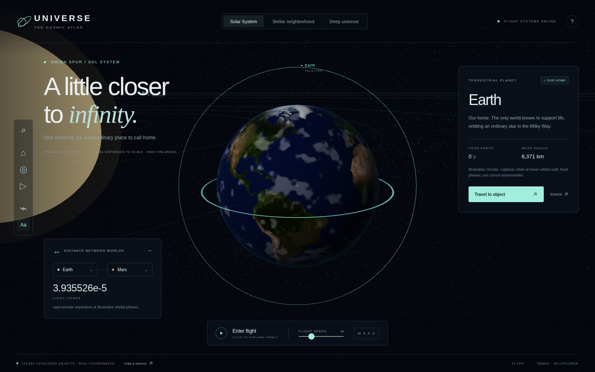

# Universe

An English-language, three-dimensional cosmic atlas. Fly from Earth through the Solar System, a real stellar catalog, and a curated deep-universe map. Built with TypeScript, Three.js, and Vite. Mouse/keyboard and standard gamepad flight are included.



## Run

Requires Node.js 22.12+ (or Node.js 24) and a modern browser with WebGL2 and hardware acceleration.

```sh
npm ci
npm run dev
```

Open the local URL printed by Vite (normally http://localhost:5173). Open the application in its own browser tab for reliable mouse capture. A local server is required; opening index.html directly does not work.

```sh
npm test              # coordinate math, distance units, import validation, controller deadzone, catalog integrity
npm run build         # TypeScript validation + production build
npm run preview       # serve the production build
npx playwright install chromium
npx playwright test   # automated browser interactions + simulated standard gamepad
```

Playwright uses `/usr/bin/chromium` when available and otherwise its own installed Chromium. Browser tests use a local server. No API key, account, or backend is required. The bundled catalogs work offline after the application is served. Fonts fall back to system fonts if Google Fonts is unavailable.

## Explore

- **Solar System:** eight planets and the Sun, illustrative fixed circular orbits. Mean orbital distances are to scale; body radii are enlarged for visibility.
- **Stellar neighborhood:** 109,400 HYG stars with usable distances and 6,436 NASA archive exoplanets, plus selected black holes. Radial distance is logarithmically compressed for navigation.
- **Deep universe:** a small curated set of galaxies and supermassive black holes. Direction is preserved, distance is logarithmically compressed, and appearances/sizes are illustrative.
- **Atlas search:** search by object name or exoplanet host, filter by type, and travel to any result. All records are searchable; results are paginated to avoid building thousands of DOM elements.
- **Distance tool:** choose any two endpoints. Reports the Euclidean separation of the original, uncompressed catalog coordinates in light-years, independently of the current view scale.
- **Guided journey:** seven manually advanced stops from Earth to M87*.
- **Dark matter:** optional artistic violet filaments. These are not measured dark-matter structures.
- **Quality:** high-resolution rendering can be disabled in the handbook to improve performance.

The application includes **115,857 catalog objects** in its initial snapshot. This does **not** represent every discovered object in the universe. There is no single complete, exact 3D catalog of all planets, stars, galaxies, and black holes. Missing distances, survey limits, uncertainty, and unresolved systems constrain any atlas.

## Flight controls

| Action | Mouse / keyboard | Standard gamepad |
| --- | --- | --- |
| Look | Click scene to capture mouse; move mouse | Right stick |
| Move / strafe | W A S D | Left stick |
| Rise / descend | Space / Ctrl or Q | RT / LT |
| Boost | Shift | LB |
| Travel to selected object | F or Travel button | A / Cross |
| Return to Earth | H or Home button | X / Square |
| Next landmark | Atlas or tour | Y / Triangle |
| Open / close atlas | C / close button; slash opens search | Start / Options |
| Select in scene | Double-click at crosshair | Use Y for curated landmarks |
| Release mouse | Esc | B / Circle |

Connect a gamepad and press a button to expose it to the browser. Standard-mapped controllers only; unsupported controller mappings are ignored. An axis deadzone prevents drift. Gamepad flight works without mouse capture. Catalog menus use keyboard or mouse. Menus pause flight, and Start/Options closes the atlas. Inputs do not move the camera while typing. The speed slider spans 0.1×–1,000×. Shift/LB adds an 8× boost. Reduced-motion preferences disable cinematic travel transitions.

## Data and scientific limits

The snapshot date and counts are in `public/data/manifest.json` and the in-app **Data & science** handbook.

| Source | Coverage in this snapshot | Attribution / license |
| --- | --- | --- |
| [HYG Database v4.1](https://github.com/astronexus/HYG-Database) | 109,400 stars with positive finite distances; missing-distance sentinel rows excluded | David Nash / Astronomy Nexus and HYG contributors; **CC BY-SA 4.0**. Transformed coordinate/label extract is `public/data/stars.json`. |
| [NASA Exoplanet Archive](https://exoplanetarchive.ipac.caltech.edu/) | 6,436 of 6,464 confirmed `pscomppars` records; 28 omitted for missing/nonpositive distances or coordinates | NASA Exoplanet Archive, operated by the California Institute of Technology under contract with NASA through the Exoplanet Exploration Program. See archive [acknowledgements](https://exoplanetarchive.ipac.caltech.edu/docs/acknowledge.html). |
| [NASA Planetary Fact Sheets](https://nssdc.gsfc.nasa.gov/planetary/factsheet/) | Mean orbital radii and body radii of eight Solar System planets and Sun | NASA / NSSDC |
| Curated NASA / ESA / EHT references | 12 galaxy / black-hole landmarks | Each object carries its reference link. Distances are rounded, approximate reference values. |

HYG and exoplanet right ascension and declination use the **J2000 equatorial frame**, with catalog distances converted to light-years (1 parsec = 3.261563777 ly). The mapping is `x = d cos(dec) cos(ra)`, `y = d sin(dec)`, `z = −d cos(dec) sin(ra)`. The stellar catalog is effectively centered on the Solar System; the annual Earth–Sun offset is neglected at interstellar scales. Solar positions use a separate illustrative orbital plane.

**No live ephemerides:** Solar System distances depend on fixed artistic orbital phases, not current time. Earth uses a Solar System Scope daymap texture (CC BY 4.0) with illustrative cloud/lighting effects. Other planet surfaces are procedural illustrations; none are live imagery. Stellar positions do not include proper-motion propagation, uncertainty ellipsoids, extinction, or relativistic corrections. Background stars are decorative and not catalog measurements.

**Exoplanets:** coordinates represent the host star, not a resolved orbital location. The app explicitly reports **Unresolved** between different planets of the same host, rather than presenting a false zero. Host-to-planet distance cannot be inferred from this view. Semi-major axes in descriptions are orbital parameters, not instantaneous 3D separations.

**Galaxies and black holes:** a curated demonstration, not an exhaustive survey. The Milky Way marker denotes its center, and M87* shares its galaxy's unresolved position. Marker overlap does not imply that all components occupy one physical point. Galaxy separations use approximate local Euclidean geometry, not cosmological comoving or luminosity-distance transformations. Black-hole accretion disks and galaxy morphologies are stylized, not ray-traced observations. Radii and orientations are illustrative.

**Dark matter is invisible.** The filament overlay is an artistic aid, not an observed map. The data does not establish the location of dark matter.

### Refresh bundled data

Python 3 with its standard library and network access is sufficient:

```sh
npm run data:refresh
npm test
npm run build
```

This fetches NASA TAP `pscomppars` records and HYG v4.1, then replaces the local JSON snapshots and manifest. Review changes, attribution, source availability, and counts before committing. Data coverage naturally changes; update README snapshot counts after refreshing. Runtime never needs these upstream APIs.

### Import your own catalog

In the atlas, choose **Import catalog** and select a JSON array. Up to 20,000 objects / 12 MB per import. Imported records are session-only (reload clears them) and explicitly marked as unverified. Names and descriptions are rendered as text.

```json
[
  {
    "name": "Example star",
    "kind": "Star",
    "ra": 219.9,
    "dec": -60.8,
    "distanceLy": 4.37,
    "description": "Your source or observational notes."
  }
]
```

Use `Planet`, `Star`, `Black hole`, or `Galaxy`; J2000 RA in degrees `[0,360)`, declination in degrees `[-90,90]`, and a positive finite distance in light-years. A source link is not automatically assigned to unverified imports.

## Hosting

`npm run build` produces a static `dist/` directory. Serve it with any static host. For ordinary root hosting, the default base path is `/`. GitHub Actions builds use `/Universe/`; change `vite.config.ts` if you rename the repository or host at a custom path.

A manual **Publish Universe to GitHub Pages** workflow is included. In repository Settings → Pages, select **GitHub Actions** as the source, then run that workflow from Actions. It validates, builds, and deploys the static app. It does not publish automatically on code pushes. The separate validation workflow runs unit tests, production build, and browser tests on pushes and PRs.

## Project structure

- `src/catalog.ts`: data model, coordinate conversion, distance math, data loading and import validation.
- `src/engine.ts`: three-dimensional scenes, procedural materials, camera travel, picking and projected labels.
- `src/controls.ts`: pointer-lock, keyboard and standard gamepad input.
- `src/main.ts` / `src/style.css`: responsive English interface, search, measurements, tour and handbook.
- `public/data/`: versioned offline catalog snapshots and manifest.
- `scripts/refresh_catalogs.py`: reproducible public-source downloads.
- `tests/`: numeric/data checks and Playwright browser scenarios.

Earth texture: [Solar System Scope](https://www.solarsystemscope.com/textures/), CC BY 4.0, distributed locally in `public/textures/earth-daymap.jpg`.

Application code is MIT-licensed. HYG-derived data remains CC BY-SA 4.0; see `DATA-LICENSE.md`. Third-party packages retain their licenses.
